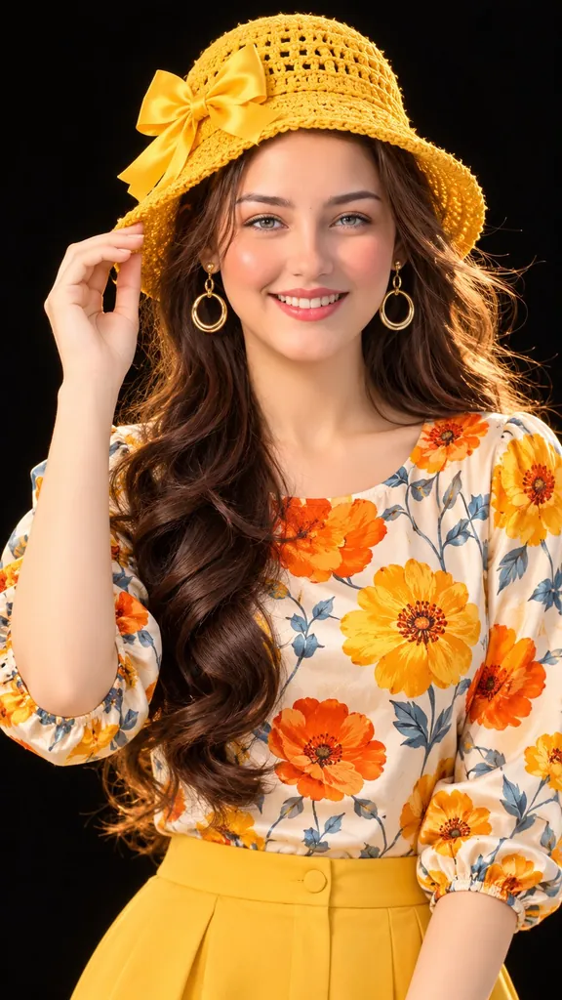

# Golden Rim-Light Portrait on Black — by @AizaAi12

[← Back to Community Examples](../../EXAMPLES.md) · Category: Photography · Model: `GPT Image 2`

<a href="https://x.com/AizaAi12/status/2123380215317676180"></a>

Source: **[@AizaAi12 on X](https://x.com/AizaAi12/status/2123380215317676180)** · Creator: [Aiza](https://x.com/AizaAi12)

## Prompt

```text
Professional portrait photography, 9:16 vertical composition, a stunning elegant East Asian woman, upper body shot against a deep black solid background.

She has long, voluminous wavy black hair flowing beautifully in soft wind, warm golden rim lighting glowing along her hair and shoulders. She wears a bright mustard-yellow crocheted bucket hat with an elegant large satin bow on the left side. Large polished gold double-hoop drop earrings.

She wears a silky cream-white blouse with vibrant vintage floral pattern — blooming orange and golden poppies, soft blue leaves and stems, puffed elbow-length sleeves. Paired with high-waisted soft yellow trousers or skirt. Her right hand gently touches the brim of her hat, graceful pose, warm confident gaze looking directly at the viewer, subtle soft smile.

Soft studio lighting, warm golden tones, high-end fashion aesthetic, sharp focus on face, ultra-detailed, photorealistic, 8K resolution, vibrant yet elegant colors, cinematic quality, polished skin texture, refined and timeless elegance.
```

## Try it

Paste the prompt into **[vinano.ai](https://vinano.ai?utm_source=github&utm_medium=readme&utm_campaign=awesome-image-video-prompts-updating&utm_content=x-page-try)** to generate your own version.

> The image and prompt belong to @AizaAi12 ([original post](https://x.com/AizaAi12/status/2123380215317676180)) and are shown here with credit for reference. Creators can ask for changes or removal by opening an issue.
