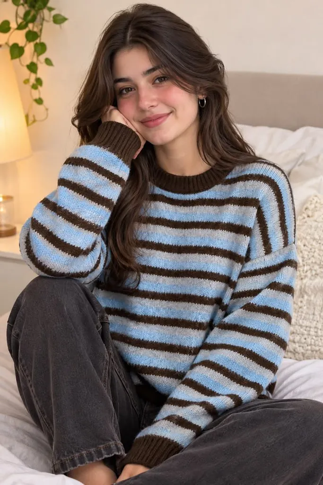

# Cozy Striped Sweater Portrait — by @AIwithRubii

[← Back to Community Examples](../../EXAMPLES.md) · Category: Photography · Model: `GPT Image 2`

<a href="https://x.com/AIwithRubii/status/2122742391270723825"></a>

Source: **[@AIwithRubii on X](https://x.com/AIwithRubii/status/2122742391270723825)** · Creator: [Rubi](https://x.com/AIwithRubii)

## Prompt

```text
A beautiful young woman with long, naturally wavy dark brown hair, wearing an oversized fluffy knitted sweater with light blue, white, and dark brown horizontal stripes, paired with charcoal grey baggy jeans. She is sitting comfortably on a cozy bed, resting her cheek gently on one hand and smiling softly at the camera. Warm bedroom setting with cream-colored walls, soft pillows, a glowing bedside lamp, and a hanging green plant. Natural window lighting, realistic skin texture, detailed knitted fabric, candid lifestyle photography, cozy autumn aesthetic, 85mm lens, shallow depth of field, professional fashion photography, ultra-realistic 4K, vertical 9:16.
```

## Try it

Paste the prompt into **[vinano.ai](https://vinano.ai?utm_source=github&utm_medium=readme&utm_campaign=awesome-image-video-prompts-updating&utm_content=x-page-try)** to generate your own version.

> The image and prompt belong to @AIwithRubii ([original post](https://x.com/AIwithRubii/status/2122742391270723825)) and are shown here with credit for reference. Creators can ask for changes or removal by opening an issue.
