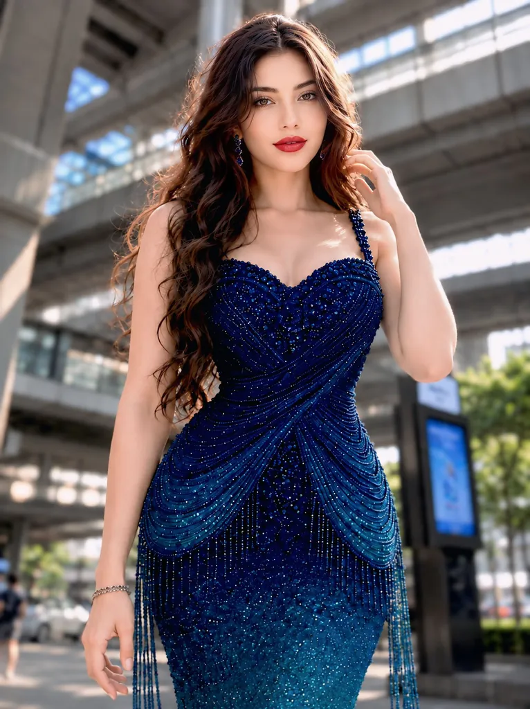

# Royal Blue Evening Gown Under City Lights — by @AyeshaEvie

[← Back to Community Examples](../../EXAMPLES.md) · Category: Photography · Model: `GPT Image 2`

<a href="https://x.com/AyeshaEvie/status/2123411037718462564"></a>

Source: **[@AyeshaEvie on X](https://x.com/AyeshaEvie/status/2123411037718462564)** · Creator: [Ayesha](https://x.com/AyeshaEvie)

## Prompt

```text
Glamorous woman with long, wavy dark brown hair and bold red lipstick posing outdoors against a modern concrete elevated transit structure and city street, wearing a fitted royal blue and teal beaded evening gown with a sweetheart neckline, draped waist, and hanging bead fringe, left hand raised near her hair, subtle blue drop earrings and a delicate bracelet, natural daylight, shallow depth of field, medium shot, photorealistic editorial portrait.
```

## Try it

Paste the prompt into **[vinano.ai](https://vinano.ai?utm_source=github&utm_medium=readme&utm_campaign=awesome-image-video-prompts-updating&utm_content=x-page-try)** to generate your own version.

> The image and prompt belong to @AyeshaEvie ([original post](https://x.com/AyeshaEvie/status/2123411037718462564)) and are shown here with credit for reference. Creators can ask for changes or removal by opening an issue.
