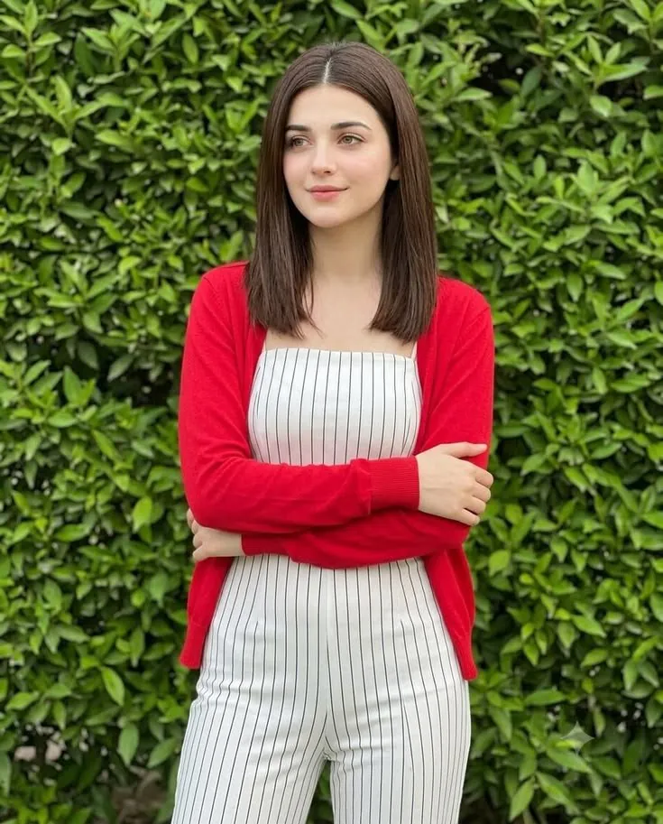

# Touch of Red in Front of a Green Hedge — by @AIwithRubii

[← Back to Community Examples](../../EXAMPLES.md) · Category: Photography · Model: `GPT Image 2`

<a href="https://x.com/AIwithRubii/status/2124136460114956664"></a>

Source: **[@AIwithRubii on X](https://x.com/AIwithRubii/status/2124136460114956664)** · Creator: [Rubi](https://x.com/AIwithRubii)

## Prompt

```text
A photorealistic cinematic portrait of a beautiful young woman standing outdoors in front of a lush, dense green hedge. She has straight, shoulder-length dark brown hair with a center part, natural makeup, and a soft, confident expression. She is wearing a bright red cardigan over a fitted white sleeveless jumpsuit with thin vertical black stripes. Her arms are gently crossed, creating a relaxed and elegant pose. She looks slightly to the side with a subtle smile. Soft natural daylight, realistic skin texture, detailed fabric, professional fashion photography, shallow depth of field, beautifully blurred green foliage, DSLR quality, 4K resolution. Preserve natural body proportions and realistic facial details.
```

## Try it

Paste the prompt into **[vinano.ai](https://vinano.ai?utm_source=github&utm_medium=readme&utm_campaign=awesome-image-video-prompts-updating&utm_content=x-page-try)** to generate your own version.

> The image and prompt belong to @AIwithRubii ([original post](https://x.com/AIwithRubii/status/2124136460114956664)) and are shown here with credit for reference. Creators can ask for changes or removal by opening an issue.
