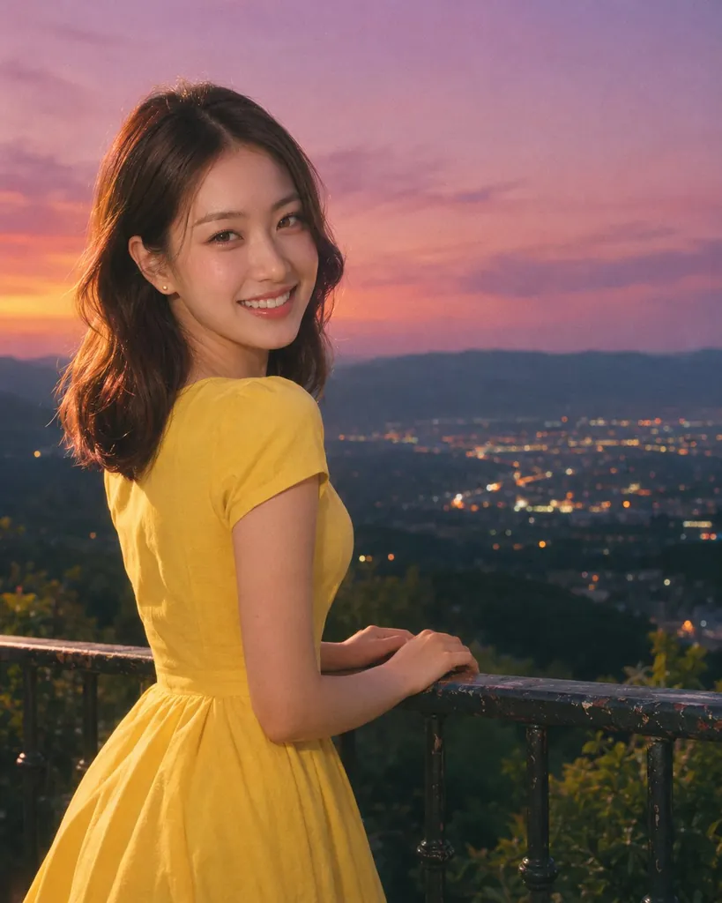

# Yellow Dress at a Hilltop Lookout at Dusk — by @cheoneusin

[← Back to Community Examples](../../EXAMPLES.md) · Category: Photography · Model: `GPT Image 2.6`

<a href="https://x.com/cheoneusin/status/2126455681884831940"></a>

Source: **[@cheoneusin on X](https://x.com/cheoneusin/status/2126455681884831940)** · Creator: [천유신](https://x.com/cheoneusin)

## Prompt

```text
A cinematic 35mm film photograph of a woman in a canary-yellow swing dress at a hilltop lookout at dusk, hands on the railing, glancing back over her shoulder with a bright smile while the city lights begin to come on.

This image is one single photograph with one pose only. It is never a collage, a photo strip, a grid, split panels, a border or more than one frame.

## Hair and makeup
Soft waves — Shoulder-length dark hair is set in loose soft waves with a side part, one side tucked behind the ear.
Skin Tint — A sheer tint that evens the color but leaves freckles and texture, with a soft glow on the cheekbones.
tightline — A hair-thin dark line along the upper lash roots defines the eye with no visible wing.
Coral Blush — A sheer coral-pink tint on the cheeks with a slight shimmer that reads fresh and warm.
Glazed Lips — Soft peach-beige lips under a milky gloss, shiny in the center.

## Expression
Glad glance — Her eyes brighten and her smile widens as if she just heard her name called from behind.
lens gaze — Her eyes come back over her right shoulder and land on the lens.

## Outfit
Swing dress — A canary-yellow cotton swing dress with a round neckline, short sleeves, a fitted bodice and a full skirt, the cotton holding a soft matte sheen in the last sun.
Plain studs — Small plain gold stud earrings catch one small highlight each.

## Props and nails
Short nails — Short rounded nails in a sheer neutral pink.

## Pose
Over-the-Shoulder Glance — Both hands rest on the iron railing in front of her, her weight on her left leg, her body turned three-quarters away and her head turned back over her right shoulder.

## Style
Golden-hour musical — A dreamy still from a classic Hollywood musical, hopeful and a little wistful.
palette — Canary yellow against dusk purple, rose and deep teal, with the city lights as small warm points.

## Scene
Hilltop lookout — A paved hillside lookout with a black iron railing, and far below a wide valley of city lights beginning to glow under a purple dusk sky.
She is alone in the frame. No writing, signs, logos or labels anywhere in the image.

## Light
dusk sky glow — The sky glows orange, rose and violet from behind the hills, giving a soft warm rim light on her hair and the left side of her face while the front falls into gentle shadow.
catchlight — A soft sky-colored glint sits in each eye.

## Optics
Kodak Portra 400 — Warm natural color film with soft skin tones, gently rolled-off highlights and lifted shadows leaning a little teal.
film grain — Fine, even 35mm grain sits across the whole frame, slightly heavier in the shadows.
Soft halation — Each bright sky edge blooms a faint warm halation glow.

## Camera
Waist-up framing — The frame runs from the top of her head to her waist, shot from slightly below eye level about three meters away, with her in the left third and the glowing valley filling the rest.
natural perspective — A moderate telephoto lens keeps the face natural with no wide-angle stretch.

SUBJECT: An adult woman in her twenties. She has a very slim, skinny build with slender arms and legs and a narrow waist. Face identity comes only from the attached character reference; do not copy any real celebrity face.

No captions, no dates, no timestamps, no watermark, no stickers, no doodles, no frame borders and no overlay text anywhere in the image.
No logos, brand marks, monograms or brand lettering anywhere on clothing, props, furniture or background.

## Finish
photograph — The whole frame reads as a real cinematic 35mm film photograph, not a phone snapshot or a fashion shoot.
photorealistic — Ultra-realistic 8K photographic detail: real pores on the skin, real weave in the cotton, real scuffs on the iron.
real photograph — A real person photographed on location, never an illustration, anime frame, 3D render or plastic-skinned CGI.
```

## Try it

Paste the prompt into **[vinano.ai](https://vinano.ai?utm_source=github&utm_medium=readme&utm_campaign=awesome-image-video-prompts-updating&utm_content=x-page-try)** to generate your own version.

> The image and prompt belong to @cheoneusin ([original post](https://x.com/cheoneusin/status/2126455681884831940)) and are shown here with credit for reference. Creators can ask for changes or removal by opening an issue.
