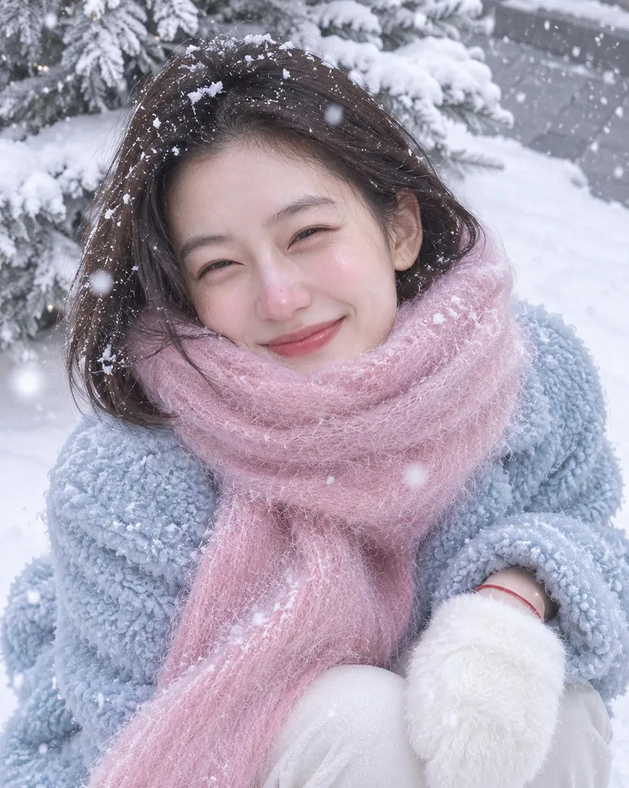

# First Snow Pink Scarf Snapshot — by @cheoneusin

[← Back to Community Examples](../../EXAMPLES.md) · Category: Photography · Model: `GPT Image 2.6`

<a href="https://x.com/cheoneusin/status/2126172980468404341"></a>

Source: **[@cheoneusin on X](https://x.com/cheoneusin/status/2126172980468404341)** · Creator: [천유신](https://x.com/cheoneusin)

## Prompt

```text
A bright winter snapshot of a woman crouched low in fresh snow in front of a frosted Christmas tree, a thick pink mohair scarf wrapped up to her chin and her head tipped to one side in a wide crescent-eyed smile as snowflakes fall around her.

## Identity Reference
If a model reference is provided, the woman in this photo is that model: take only the 얼굴형 and 이목구비 from it, adapting them naturally to this scene's expression, angle and light, and keep her own skin tone. Hair, makeup and everything else follow this prompt. If none is provided, she is a 22-year-old Korean woman with a 청순 face: 순한 이목구비, 작은 얼굴, 오똑한 콧대, a clean 턱선 and 맑고 흰 쿨톤 피부. In either case 7.5등신, 작은 머리 over 직각어깨 and 긴 목.

## Hair and makeup
눈 맞은 단발 — Soft dark-brown hair falls just past the jaw with loose, slightly tousled ends, a few strands blown across the cheek and the scarf, and small white snowflakes caught on the crown and along the left side of the hair.
冻伤妆 — A cold pink flush sits high on both cheeks and across the bridge and tip of the nose, as if just out of winter air, with a faint fine shimmer of glitter on the near cheekbone.
촉촉한 레드 립 — The lips hold a glossy cherry-red tint, closed in a wide smile with the corners lifted.
자연 눈썹 — Natural soft-brown brows and short dark lashes, with no visible eyeliner wing.

## Expression
눈웃음 — The eyes curve into crescents as the lower lids rise with the smile, the gaze meeting the lens, the mouth closed and stretched wide, the whole face relaxed and delighted.

## Outfit
핑크 모헤어 머플러 — A wide, fluffy pastel-pink mohair scarf is wound twice around the neck up to the chin and jaw, one long loose end draping down the front of the chest in soft folds, with a fine fuzzy halo along every edge.
하늘색 테디 코트 — A powder-blue teddy-boucle coat with a dense curly pile covers the shoulders and arms, the fuzz catching the light along the near shoulder and sleeve.

## Props and nails
흰 털장갑 — A chunky white faux-fur mitten sits at the lower right edge of the frame, the hand resting low on the knee, with a thin red string bracelet visible at the wrist just above it.
눈송이 — Large, soft, out-of-focus snowflakes drift across the whole frame in front of and behind her, a few big blurred flakes passing over the face and the scarf, smaller sharp flakes dotting the tree and the ground.

## Pose
고개 기울임 — She crouches low in the snow with the torso facing the lens and turned slightly to frame right, the head tilted about twenty degrees toward frame left so the hair falls to that side, the chin tucked into the scarf, and one mittened hand resting low at the lower right.

## Style
겨울 스냅 — A cheerful first-snow portrait with clean, airy whites, soft pastel colour and a light, playful feel.
palette — Bright white in the snow and the flocked branches (#eee5ec), pastel pink in the scarf and the flushed cheeks (#be9da3), powder sky blue in the coat (#95b5cf), slate blue-grey in the shaded tree and paving (#647086), and charcoal brown in the hair (#322e36).

## Scene
눈 덮인 트리 — A tall Christmas tree heavily flocked with white snow fills the upper left behind her head, its frosted branches slightly soft.
눈밭 — Fresh snow covers the ground all around her and fills the lower left and right edges of the frame in clean white.
보도블록 — In the upper right corner a strip of dark grey square paving tiles and a low step show behind the snow, slightly out of focus.

## Light
그림자 — Soft, pale blue-grey shadows sit under the jaw, in the folds of the pink scarf and in the curly pile of the coat, with only the edge under the chin reading a little crisp, and the shadow saturation stays low.
snowlight — Bright, diffuse daylight from the pale sky and the snowy ground wraps the face evenly from the right and from below, lifting the chin, the cheeks and the underside of the scarf with clean cool light and almost no shadow edge.
catchlight — A small soft white highlight sits in the upper part of each eye.

## Optics
雪地反光 — The snow bounces light upward so the whole frame stays high-key, the white snow and sky areas clipping softly to pure white at the brightest points.
浅景深 — The face, hair and scarf are sharp while the flocked tree and the paving behind fall into gentle blur and the nearest snowflakes become soft round discs.
lifted blacks — The darkest hair and tree shadows stay slightly lifted, never going to pure black, with a cool, slightly magenta-blue white balance across the frame.

## Camera
vertical frame — The crop runs from just above her head to the waist, placing her face slightly left of centre in the upper half, the scarf filling the lower middle and the mitten at the lower right edge, shot from slightly above her eye line a short distance away.
自然透视 — Shot with a standard portrait lens at a moderately wide aperture, 自然透视 keeping the face and shoulders in natural proportion.

## Finish
실사 — The whole frame reads as a real winter portrait photograph, never a digital painting or studio composite, with no text, caption, watermark or logo laid over the image.
극사실 — Ultra-realistic 8K photographic optical rendering: authentic mohair halo on the scarf, real curly pile on the coat, real snow crystals and genuine skin sheen.
실사 촬영 — A real person photographed on location, never an illustration, anime frame, 3D render or plastic-skinned CGI.
```

## Try it

Paste the prompt into **[vinano.ai](https://vinano.ai?utm_source=github&utm_medium=readme&utm_campaign=awesome-image-video-prompts-updating&utm_content=x-page-try)** to generate your own version.

> The image and prompt belong to @cheoneusin ([original post](https://x.com/cheoneusin/status/2126172980468404341)) and are shown here with credit for reference. Creators can ask for changes or removal by opening an issue.
