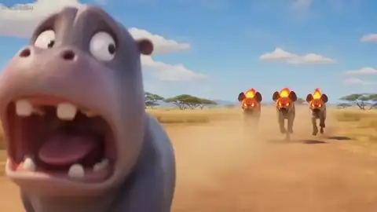

# Savanna Animals Transform into a Getaway Car — by @Viniai_

[← Back to Community Examples](../../EXAMPLES.md) · Category: Video · Model: `Seedance 2.5`

<a href="https://x.com/Viniai_/status/2124340476136525832"></a>

**[▶ Watch the full video on X](https://x.com/Viniai_/status/2124340476136525832)** — the preview above is a short silent clip.

Source: **[@Viniai_ on X](https://x.com/Viniai_/status/2124340476136525832)** · Creator: [Vini](https://x.com/Viniai_)

## Prompt

```text
Style + characters

Premium 3D animated comedy adventure, feature-film cartoon quality, soft global illumination, bright saturated colors, bouncy squash-and-stretch animation, 16:9, 24fps, cinematic camera moves. Setting: a sunny African savanna with golden grass, a dusty dirt road, acacia trees and a blue sky with fluffy white clouds. BERRY: a chubby baby purple-grey hippo with big buck teeth and huge expressive eyes. PIPI: a small cute green baby crocodile with a big toothy smile. RUSTY: a round brown baby warthog with a tuft of hair and small tusks. THE HYENAS: three sneaky spotted hyenas with glowing orange eyes. Everything transforms in a smooth, satisfying, mechanical "Transformers-style" way, with animal skin texture and colors carried onto the vehicles (the hero car is purple with green crocodile-skin panels and brown warthog parts; the villain vehicle is covered in spotted hyena fur).

Sound (every clip): loud, crisp, full-range cinematic cartoon sound design, no dialogue (only screams, laughs and grunts), a fast fun action-comedy energy. Deep mechanical transformation clanks and servo whirs, punchy whooshes, roaring engines with sub-bass, rocket-booster blasts, tyre screeches, gravel spray, wind rush.

CLIP 1 (0–9s): The trio turns into a car

Shot 1: extreme close-up of Berry the baby hippo screaming in panic at the camera, three hyenas with glowing orange eyes racing toward him down the dirt road behind him. Shot 2: Rusty the warthog runs, leaps and flattens his body into a long smooth plank on the road. Shot 3: the plank unfolds, four chunky off-road wheels pop out and it becomes a car chassis with Rusty's face on the front. Shot 4: Berry jumps high in the air and lands on top, his body stretching into a sleek purple car shell. Shot 5: Pipi the crocodile dives on top and wraps over the roof, his green scales becoming the panels, a rear spoiler unfolds. Shot 6: the finished purple-green sports car revs, blue rocket flames burst from the exhausts, and it blasts off down the road, leaving tyre marks and dust.
Sound: a panicked baby-hippo scream, the hyenas' cackling and pounding paws, a springy "boing" as Rusty jumps, metallic unfolding clanks and servo whirs, wheels locking in with heavy thunks, a body-panel "chunk-chunk", a deep engine start roar, then a rocket-booster blast and fading engine whine.

CLIP 2 (9–19s): Hyena buggy and the train

Shot 1: the empty dirt road with fresh tyre tracks and settling dust. Shot 2: two hyenas run side by side, their bodies fuse and wheels sprout under them. Shot 3: close-up of the chassis forming, huge knobby off-road tyres slamming down. Shot 4: the finished spotted-fur monster buggy, red tail-lights flaring, red flames blasting from its exhaust as it launches. Shot 5: aerial shot, a long old steam train races across the savanna, the purple car and the hyena buggy speeding alongside it. Shot 6: inside the train cab, a grumpy donkey engine driver in a blue conductor cap glances at them. Shot 7: low side shot, both cars race beside the steam train's wheels, sparks flying off the rails.
Sound: rumbling engine, fur-and-metal transformation crunches, heavy tyre thuds, a growling V8 roar and fire bursts, a steam whistle blast, rhythmic chugging train wheels, the donkey's annoyed snort, screeching metal sparks, two engines roaring side by side.

CLIP 3 (19–31s): Cliff jump and the car becomes a jet

Shot 1: the purple car bursts out of a rock tunnel and flies off a canyon edge, blue boosters glowing. Shot 2: the hyena buggy flies after it past the red rock cliff. Shot 3: chase shot behind the purple car speeding across the savanna, sparks scraping off the bottom. Shot 4: the car races up a grassy hill and launches into the air. Shot 5: extreme close-up inside the engine, gears, pipes and a glowing orange core spinning up. Shot 6: mid-air, the car's wheels fold away, wings and jet engines slide out and it transforms into a purple-green jet plane flying into the clouds.
Sound: a tunnel echo whoosh, a huge engine roar on the jump, wind rush, gravel and spark scraping, a deep mechanical power-up hum rising in pitch, rapid transformation clanks, and a powerful jet-turbine scream as it takes off into the sky.

CLIP 4 (31–44s): Sky chase and the airplane passenger

Shot 1: the hyena buggy launches off a dusty hill and flies through the air. Shot 2: it transforms mid-air into a spotted hyena-fur jet with sharp wings. Shot 3: inside a passenger airplane, a baby rhino sits calmly by the window. Shot 4: the purple jet zooms past the window and the hyena jet follows. Shot 5: the shocked baby rhino covers his eyes with both hands. Shot 6: the hyena jet appears right outside the window with big googly cartoon eyes staring in. Shot 7: point of view from the purple jet's nose, diving down through the clouds toward the ocean. Shot 8: wide shot, the jet dives into the sea with a big white splash, the hyena jet right behind.
Sound: engine roar and transformation clanks, a jet flyby whoosh, the soft airplane cabin hum with a gentle ding, the fast doppler roar of two jets passing the window, a baby rhino's tiny gasp, a comic "boing" on the googly eyes, a howling wind dive, and a huge water-impact splash.

CLIP 5 (44–63s): Underwater, the orca and the shark

Shot 1: underwater over a colorful coral reef full of tropical fish, the purple jet transforms into a round submarine with a spinning propeller. Shot 2: the hyena jet crashes into the water and becomes a spotted submarine chasing behind. Shot 3: both subs zoom through the coral reef. Shot 4: a big friendly orca swims in out of the deep blue. Shot 5: on the beach, Berry, Pipi and Rusty burst out of the water riding next to the smiling orca, splashing. Shot 6: close-up of the orca happily smiling. Shot 7: the trio waves goodbye on the shore and walks onto the savanna. Shot 8: the three hyenas stand dripping on the beach and a huge great white shark rises out of the water behind them. Shot 9: the hyenas scream and run away. Shot 10: final close-up, Berry, Pipi and Rusty laughing together at the camera.
Sound: muffled underwater ambience with bubbles, propeller whirring, a submarine sonar "ping", a deep orca call, a big splash breaking the surface, waves crashing on the beach, happy laughs, then a deep ominous shark rumble, the hyenas' screams and scrambling paws, and a final burst of loud group laughter with a comic "ding".
```

## Try it

Paste the prompt into **[vinano.ai](https://vinano.ai?utm_source=github&utm_medium=readme&utm_campaign=awesome-image-video-prompts-updating&utm_content=x-page-try)** to generate your own version.

> The video and prompt belong to @Viniai_ ([original post](https://x.com/Viniai_/status/2124340476136525832)) and are shown here with credit for reference. Creators can ask for changes or removal by opening an issue.
